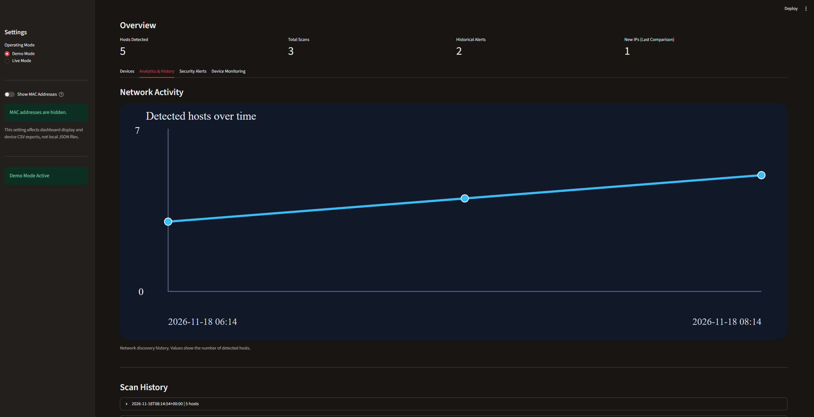

# 🛡️ NetworkGuard

[](https://github.com/ronD2K/NetworkGuard/actions/workflows/tests.yml)

**A Python-based Home Network Monitoring Application**

NetworkGuard is a personal software development project focused on Python programming, networking fundamentals, cybersecurity, and automated testing.

It uses Nmap to discover active devices on authorized local networks and provides an interactive Streamlit dashboard for monitoring devices, reviewing scan history, and identifying newly detected IP addresses.

## 📸 Dashboard Preview

NetworkGuard includes an interactive dashboard built with Streamlit.

The screenshot below demonstrates NetworkGuard in **Demo Mode**, using simulated network data.



> Demo Mode uses simulated IP and MAC addresses. No real network scanning is performed.

## ✨ Features

### Network Discovery

- Discover active hosts using Nmap.
- Identify IPv4 addresses.
- Collect available MAC addresses and vendor information.
- Detect newly discovered devices and IP addresses.
- Compare results from consecutive scans.
- Validate private IPv4 network configurations.

### Interactive Dashboard

- Web interface built with Streamlit.
- Overview of detected devices and scan activity.
- Device search and filtering.
- Device details and status information.
- Network activity visualization using SVG.
- Historical scan records.
- New-device/IP alerts.
- Device monitoring between scans.
- CSV export for device information and scan history.

### Demo and Live Modes

**Demo Mode**
- Uses simulated network information.
- Does not perform real network scans.
- Works without Nmap.
- Suitable for demonstrations and portfolio screenshots.

**Live Mode**
- Uses Nmap for local network discovery.
- Requires an authorized private IPv4 subnet.
- Stores scan history locally.
- Compares current results with previous scans.

### Privacy Features

- MAC addresses are hidden in the dashboard by default.
- Optional Show/Hide MAC Address setting.
- Local network subnet configured through an environment variable.
- Scan result JSON files excluded from Git.
- Live scanning requires user confirmation.

> Hiding MAC addresses in the dashboard does not remove them from local JSON files.

## 🛠️ Technologies Used

| Technology | Purpose |
|------------|---------|
| Python | Core application logic |
| Nmap | Network host discovery |
| Streamlit | Interactive web dashboard |
| Pytest | Automated testing |
| GitHub Actions | Continuous Integration |
| JSON | Local data storage |
| XML | Parsing Nmap scan results |
| Git & GitHub | Version control and collaboration |

## 📂 Project Structure

```text
NetworkGuard/
|
|-- main.py
|-- scanner.py
|-- monitor.py
|-- history.py
|-- dashboard.py
|-- demo_data.py
|
|-- requirements.txt
|-- .gitignore
|-- README.md
|
|-- .github/
|   |-- workflows/
|       |-- tests.yml
|
|-- docs/
|   |-- images/
|       |-- dashboard-demo.png
|
|-- tests/
|   |-- conftest.py
|   |-- test_demo.py
|   |-- test_history.py
|   |-- test_monitor.py
|   |-- test_scanner.py
```

## 🚀 Installation

### 1. Clone the Repository

```bash
git clone https://github.com/ronD2K/NetworkGuard.git
cd NetworkGuard
```

### 2. Install Python Dependencies

Make sure Python and pip are installed.

```bash
python -m pip install -r requirements.txt
```

### 3. Launch NetworkGuard

```bash
python -m streamlit run dashboard.py
```

Open the local URL displayed in your terminal.

NetworkGuard starts in **Demo Mode** by default.

You can explore the dashboard without scanning a real network.

## 🌐 Live Network Scanning

Live Mode requires Nmap and a configured subnet.

### 1. Install Nmap

Download Nmap from:

https://nmap.org/download.html

Ensure the `nmap` command is accessible in your terminal.

### 2. Configure an Authorized Network

Set the `NETWORKGUARD_SUBNET` environment variable.

**Windows PowerShell:**

```powershell
$env:NETWORKGUARD_SUBNET="192.168.1.0/24"
```

Replace the example subnet with a private network you own or are explicitly authorized to scan.

NetworkGuard supports RFC 1918 private IPv4 networks and limits scans to a /24 or smaller range.

### 3. Start the Dashboard

```powershell
python -m streamlit run dashboard.py --server.address 127.0.0.1
```

Select **Live Mode** in the sidebar.

Confirm you have permission to scan the configured network, then select **Scan Network**.

> Only scan networks you own or have explicit permission to test.

## 📊 Dashboard Sections

### 1. Devices

Displays discovered devices, including:

- IP address
- Available MAC address
- Vendor information
- Device status

Includes search, filtering, device details, and CSV export.

### 2. Analytics & History

Displays network activity over time using an SVG chart.

Users can review previous scans and export scan history.

### 3. Security Alerts

Shows historical events where new device/IP records were detected.

A newly detected IP does not necessarily indicate malicious activity.

### 4. Device Monitoring

Compares the two most recent scan results.

Displays:

- Newly detected IP addresses
- IP addresses not detected in the latest scan

IP changes, DHCP assignments, and discovery failures may affect the results.

## 🧪 Automated Testing

NetworkGuard includes **20 automated tests** using Pytest.

Tests cover:

- Nmap XML parsing
- Mock network scanning
- Nmap timeout handling
- Missing Nmap installation
- Invalid XML handling
- Device detection and comparison
- MAC-based device comparison
- Scan history storage
- Demo Mode data validation
- Network configuration validation
- RFC 1918 private IPv4 validation
- Rejection of unsupported network ranges

### Run Tests

```bash
python -m pytest tests -v
```

The test suite uses mocked scanning for relevant test cases, so a real network scan is not required.

## ⚙️ Continuous Integration

NetworkGuard uses **GitHub Actions** for automated testing.

The workflow runs on:

- Pushes to the `main` branch.
- Pull requests targeting `main`.

GitHub Actions runs the Pytest suite to help identify regressions when the project changes.

[View GitHub Actions](https://github.com/ronD2K/NetworkGuard/actions)

## 🔐 Security and Privacy

NetworkGuard is designed for educational use and authorized local network monitoring.

Security and privacy considerations include:

- No personal network subnet hardcoded in the current scanner source.
- Local network configuration through an environment variable.
- Scan results stored locally.
- Scan data excluded from Git through `.gitignore`.
- MAC address visibility controlled in the dashboard.
- Demo Mode for public demonstrations.
- Network scan scope restricted to supported private IPv4 ranges.

**Important:** NetworkGuard does not verify network ownership or authorization.

Do not deploy Live Mode publicly without implementing appropriate access controls.

## ⚠️ Limitations

- Some devices may not respond to Nmap discovery.
- MAC addresses and vendor information may be unavailable.
- Device identification may be affected by DHCP changes.
- A missing IP does not prove a device is offline.
- New IP detection does not automatically indicate a security threat.
- Live monitoring currently requires manual scans.
- Local JSON data is not encrypted by the application.
- NetworkGuard is not a replacement for a professional intrusion detection system.

## 📚 What I Learned

Building NetworkGuard helped me practice:

- Python programming and modular code organization.
- Working with JSON and XML data.
- Using Python subprocesses to interact with command-line tools.
- Networking concepts such as IP addressing and subnet validation.
- Building interactive dashboards with Streamlit.
- Writing automated tests with Pytest.
- Mock testing and error handling.
- Using Git and GitHub for version control.
- Setting up Continuous Integration with GitHub Actions.
- Considering privacy and security in application design.

## 👨‍💻 Author

**Quang Doan**

Computer Studies and Information Systems (CSIS) Student  
Douglas College, British Columbia, Canada

Currently learning Python, networking, software development, and cybersecurity.

**GitHub:** https://github.com/ronD2K
